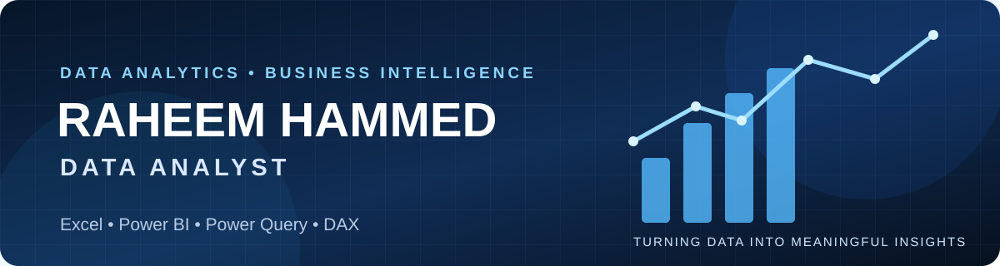

<!-- Profile banner -->

  

<h1 align="center">Hi, I'm Raheem Hammed 👋</h1>
<h3 align="center">Data Analyst | Excel • Power BI • Power Query • DAX</h3>

  
  
  

## 👨‍💻 About Me

I am a **Data Analyst** focused on transforming raw data into meaningful insights using **Microsoft Excel** and **Microsoft Power BI**. I work with data cleaning, transformation, analysis, modelling, calculations, and visualization to support informed decision-making.

I enjoy exploring datasets, identifying patterns and trends, and presenting findings through clear reports and dashboards.

## 🧰 Technical Skills & Tools

  
  
  
  

- 📊 **Microsoft Excel:** Data cleaning, formulas, PivotTables, charts, and reporting.
- 🔄 **Power Query:** Data import, transformation, and preparation.
- 📈 **Microsoft Power BI:** Data modelling, report development, dashboards, and visualization.
- 🧮 **DAX:** Measures, calculations, and KPI development.
- 🔎 **Data Analysis:** Exploring datasets, checking data quality, identifying patterns, and interpreting results.

## 🚀 Featured Projects

### 1. Demographic & Contact Data Analysis
An Excel and Power BI project exploring demographic and contact data, including data quality checks, gender distribution, email-domain analysis, and dashboard reporting.

[View Project Repository](https://github.com/horlaytan04/Demographic-Contact-Data-Analysis)

### 2. Power BI Projects
A collection of Power BI reports and exercises demonstrating data preparation, modelling, DAX calculations, and data visualization.

[View Project Repository](https://github.com/horlaytan04/Power-BI-Project)

### 3. Excel Projects
Practical projects and exercises focused on spreadsheet-based data preparation, analysis, and reporting.

[View Project Repository](https://github.com/horlaytan04/Exel-Project)

## 🎯 My Analytical Workflow

1. Understand the dataset and the business question.
2. Inspect, clean, and prepare the data using Excel and Power Query.
3. Explore the data to identify patterns and trends.
4. Model data and create relevant calculations using Power BI and DAX.
5. Build clear visual reports and dashboards.
6. Communicate findings in a useful and understandable way.

## 🌐 Find Me Online

- **Portfolio Website:** [horlaytan04.github.io/My-Portfolio](https://horlaytan04.github.io/My-Portfolio/)
- **LinkedIn:** [Hammed Raheem](https://linkedin.com/in/hammed-raheem-a87228443)
- **GitHub:** [@horlaytan04](https://github.com/horlaytan04)

---

<i>Turning data into meaningful insights.</i>

